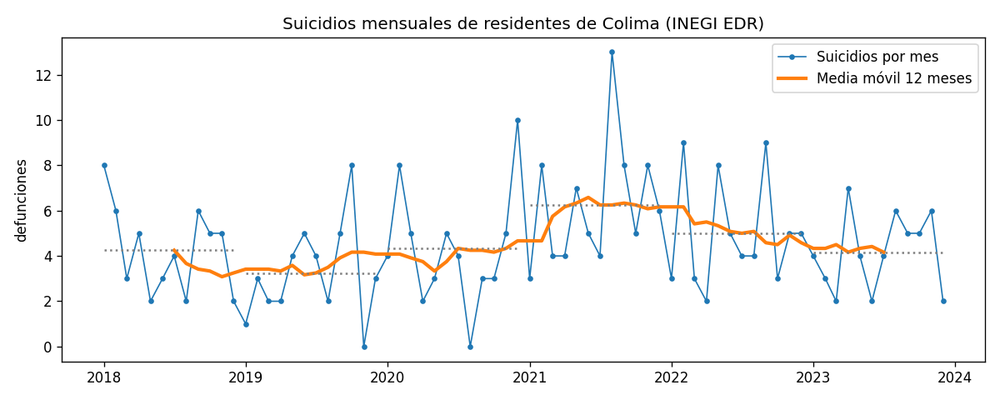
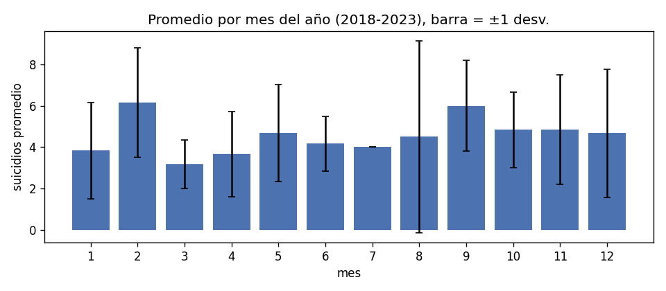
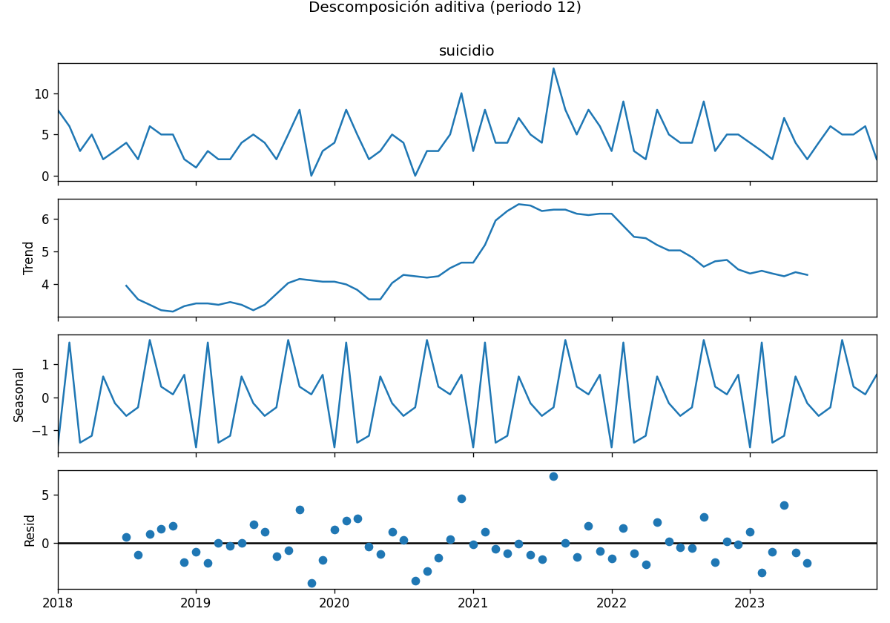
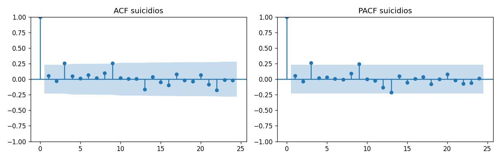
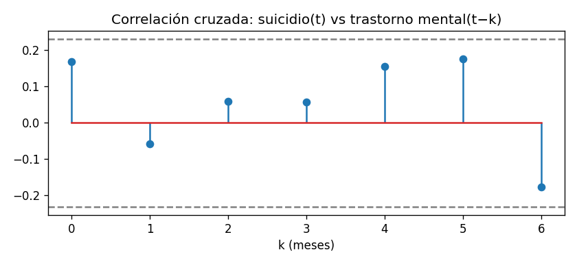
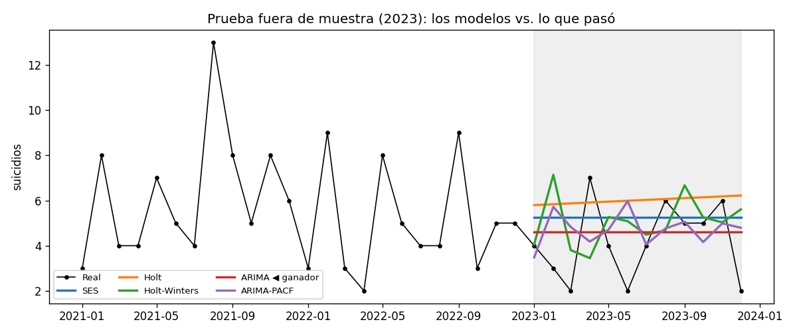
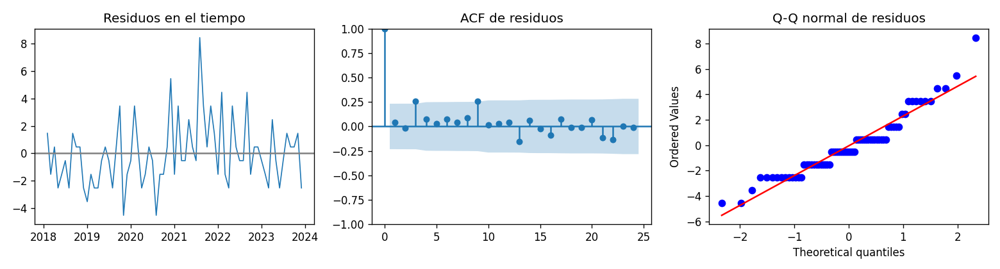
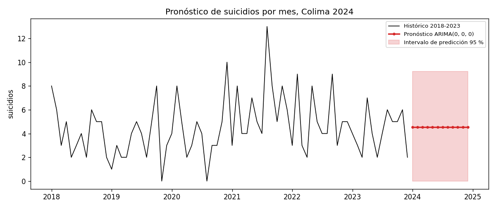

# E1 · Análisis Estadístico: caracterización y pronóstico de la serie

**Pregunta analítica E1:** ¿cuántas defunciones por lesiones autoinfligidas (suicidio, CIE-10 X60–X84) de residentes de Colima se esperan por mes en los próximos 12 meses?

- **Entrada:** `data/oro/serie_mensual_colima.csv`. Son 72 meses (enero de 2018 a diciembre de 2023) y salen de la capa Oro, con linaje hacia Bronce.
- **Código:** `src/pronostico.py`. Para reproducirlo: `python src/pronostico.py`.
- **Salidas:** las gráficas y tablas están en `docs/E1/pronostico/`, todos los números en `docs/E1/pronostico/resumen.json` y el pronóstico que lee el tablero en `data/oro/pronostico_suicidio_colima.csv`.

> Todos los números de este documento salen de `resumen.json`. Si los datos cambian, se vuelve a correr el script y se actualiza este texto.

---

## 1. Caracterización

| Dato | Valor |
|---|---|
| Periodos | 72 meses |
| Media / desviación estándar | 4.54 / 2.40 suicidios por mes |
| Mínimo / máximo | 0 (nov-2019 y ago-2020) / **13 (ago-2021)** |
| Total por año | 2018: 51 · 2019: 39 · 2020: 52 · **2021: 75** · 2022: 60 · 2023: 50 |

- **Tendencia:** no hay una tendencia sostenida. La media móvil de 12 meses sube en 2021, que fue el año posterior al confinamiento por COVID-19, y luego regresa al nivel de antes.
- **Cambio estructural:** la media de 2021–2023 (5.14) es mayor que la de 2018–2020 (3.94), y la prueba de Mann-Whitney da p = 0.040. Al revisar año por año se ve que la diferencia viene casi toda de **2021**. Para 2023 la serie ya volvió a 4.17 por mes. Esto se lee como un **choque temporal** y no como un cambio de nivel permanente.
- **Estacionalidad:** febrero (6.2) y septiembre (6.0) tienen los promedios más altos, y marzo (3.2) el más bajo. Pero la prueba de Kruskal-Wallis entre los 12 meses da **p = 0.40**: con 6 años de datos, las diferencias entre meses **no se distinguen del azar**.
- **Ciclos:** no se ven ciclos de varios años, aunque con 6 años no habría manera de detectar uno.

## 2. Descomposición: aditiva

**Por qué aditiva y no multiplicativa:**
1. La serie tiene meses con valor 0. El modelo multiplicativo divide entre el nivel, así que no está definido cuando el nivel es cero.
2. El modelo multiplicativo sirve cuando la estacionalidad crece junto con el nivel. Aquí no pasa eso: en 2021, el año con el nivel más alto, la variación no fue proporcionalmente mayor.

**Lectura:** la amplitud estacional es de 3.2 suicidios entre el mes más alto y el más bajo. Pero la **fuerza estacional es de solo 0.20** y la de tendencia también es de 0.20. Ambas usan la medida de Hyndman, que va de 0 (no hay componente) a 1 (componente dominante). El residuo explica casi toda la variación, lo cual coincide con la prueba de Kruskal-Wallis.

## 3. Estacionariedad

| Prueba | Estadístico | p | Conclusión |
|---|---|---|---|
| Dickey-Fuller aumentada (H₀: hay raíz unitaria) | −3.55 | **0.007** | Se rechaza H₀, así que la serie es estacionaria |
| KPSS (H₀: es estacionaria), como contraste | 0.38 | 0.086 | No se rechaza H₀, así que también es estacionaria |

Las dos pruebas tienen hipótesis nulas opuestas y llegan a la misma conclusión. Por eso **no hace falta diferenciar (d = 0)**. Diferenciar una serie que ya es estacionaria agrega correlación artificial y hace más anchos los intervalos.

## 4. Autocorrelación y correlación cruzada

- **ACF y PACF:** con una banda del 95 % de ±0.231, solo los rezagos **3 y 9** salen apenas por fuera, y en ambas gráficas. No aparece el rezago 12, que es lo que se vería con estacionalidad anual, ni un decaimiento gradual, que sería la señal de un proceso AR.
- La prueba de Ljung-Box sobre la serie original da p = 0.42 (rezago 12): **no se rechaza que la serie sea ruido blanco**. Con 24 rezagos probados se esperarían alrededor de 1.2 rezagos "significativos" solo por azar, y aparecieron 2.
- **Correlación cruzada con la segunda variable** (defunciones por trastornos mentales y del comportamiento, F00–F99): r = 0.17 en el mismo mes (p = 0.15), y ningún rezago de 0 a 6 meses supera la banda. **Los trastornos mentales registrados no anticipan a los suicidios.** Por eso no tiene sentido usarlos como predictor, por ejemplo en un ARIMAX.

## 5. Los cuatro modelos y sus parámetros

Todos se ajustaron con los datos de 2018 a 2022 (60 meses). Los parámetros los estima statsmodels por máxima verosimilitud.

| Modelo | Parámetros estimados | Lectura |
|---|---|---|
| **Suavizamiento simple (SES)** | α = 0.080 | Un α bajo significa que el modelo casi no reacciona al último dato y se apoya en el promedio de muchos meses. Es lo esperable en una serie ruidosa. |
| **Holt** (tendencia lineal) | α ≈ 0, β = 0 | El ajuste "apaga" la tendencia. Aun así proyecta la pendiente inicial, y por eso es el que más falla. |
| **Holt-Winters** (aditivo, tendencia amortiguada, s = 12) | α = 0.098, β = 0.015, γ ≈ 0, φ = 0.80 | γ ≈ 0 indica que el patrón estacional queda fijo y no aprende. Tiene el peor AIC (302) por los 11 parámetros estacionales extra. |
| **ARIMA(0,0,0)** con constante | c = 4.62, σ² = 6.24 | El orden se eligió así: **d = 0** por el ADF; **p y q** con una rejilla de p, q ∈ {0…3} y el **menor AIC** (284.1, en `arima_rejilla_aic.csv`). La ACF y la PACF sin estructura clara apuntaban a lo mismo: ruido blanco alrededor de una media. |
| ARIMA con p = {3, 9}, candidato extra | φ₃ = 0.23, φ₉ = 0.30 | Prueba si los dos rezagos que destacaron en la PACF ayudan a pronosticar. |

## 6. Selección con datos que el modelo no vio (prueba: los 12 meses de 2023)

| Modelo | AIC (entrenamiento) | MAE | RMSE | MAPE |
|---|---|---|---|---|
| SES | 285.5 | 1.62 | 1.95 | 59.6 % |
| Holt | 285.6 | 2.02 | 2.44 | 75.6 % |
| Holt-Winters | 302.1 | 1.85 | 2.29 | 61.3 % |
| **ARIMA(0,0,0) ← ganador** | 284.1 | **1.44** | **1.69** | **49.0 %** |
| ARIMA p = {3, 9} | **277.9** | 1.63 | 2.06 | 58.2 % |
| Referencia: media histórica | — | 1.44 | 1.69 | 49.0 % |

**Gana ARIMA(0,0,0)** en las tres métricas. Hay que decirlo con claridad: **ese modelo equivale a pronosticar la media histórica**, por eso empata con la referencia. Que los modelos más complejos no superen a la media es un **hallazgo**, no un fracaso. La serie mensual de suicidios en Colima se comporta como ruido alrededor de unos 4.5 por mes.

**La lección del ARIMA con p = {3, 9}:** tiene el **mejor AIC en el entrenamiento** (277.9) y aun así pronostica peor (RMSE 2.06). Los rezagos 3 y 9 ajustan el ruido de 2018–2022, y ese ruido no se repite en 2023. Es sobreajuste. Por eso el modelo se elige con el error en datos de prueba y no con el AIC.

**Sobre el MAPE:** es alto (49 %) porque los conteos son pequeños. Fallar por 2 cuando el valor real es 2 ya es un 100 % de error. En este caso el MAE es más fácil de interpretar: **el pronóstico se equivoca en promedio por 1.4 suicidios al mes**. El MAPE se puede calcular porque 2023 no tiene ningún mes en cero.

## 7. Residuos del ganador (re-ajustado con los 72 meses)

| Prueba | Resultado | Conclusión |
|---|---|---|
| Ljung-Box, rezagos 6 / 12 / 24 | p = 0.39 / 0.38 / 0.66 | ✅ **Aprobada**: no queda autocorrelación |
| Varianza estable (Levene, 1ª vs 2ª mitad) | var 4.7 vs 5.9; p = 0.68 | ✅ La varianza es estable |
| Normalidad (Shapiro-Wilk) | p = 0.001 | ⚠️ No es normal: tiene sesgo a la derecha por el pico de 13 en ago-2021 |

**Consecuencia de que no sea normal:** el intervalo de predicción se calcula como media ± 1.96σ, que supone normalidad. Por eso hay que tomarlo como **aproximado**. Su límite inferior daba negativo y se recortó a 0, porque no puede haber un número negativo de defunciones. Una mejora para E3 o E4 sería un modelo de conteo (Poisson o binomial negativa), que no supone normalidad.

## 8. Pronóstico 2024

| | Pronóstico | Intervalo 95 % |
|---|---|---|
| Por mes | **4.5 suicidios** | 0 a 9 |
| Total del año 2024 | **≈ 54** | ≈ 38 a 71 |
| (Referencia: real 2023) | 50 | |

El intervalo anual se calcula como 12·c ± 1.96·σ·√12, suponiendo meses independientes. Eso es razonable porque la prueba de Ljung-Box no encontró autocorrelación.

### Frase para la cliente (va en el tablero)

> "En el estado de Colima se registran en promedio entre 4 y 5 suicidios al mes, y para 2024 esperamos alrededor de 54 en el año. Con 95 % de confianza, cualquier mes puede tener entre 0 y 9; esa variación es normal y no anuncia una tendencia. Con los datos públicos disponibles **no se detecta un mes del año con riesgo claramente mayor**, así que la prevención y la difusión de sus servicios conviene que sean constantes todo el año y no solo en una temporada. La excepción histórica fue 2021 (75 casos), el año posterior al confinamiento: si vuelve a ocurrir un evento de ese tipo, conviene esperar más demanda."

## Limitaciones

- **Rezago de la fuente:** el INEGI publica las defunciones con alrededor de 10 meses de retraso, y 2024 todavía no estaba en la ruta que usa el extractor. El "pronóstico de 2024" ya se puede comparar contra los datos reales en cuanto el INEGI los publique. Esa comparación queda como validación pendiente.
- **Lo que mide la serie:** cuenta defunciones *registradas*, no la demanda de atención psicológica. Es un indicador de necesidad extrema, no de cuánta gente busca terapia.
- **Pocos datos:** con 72 meses solo se pueden detectar efectos estacionales grandes. Una estacionalidad débil y real podría existir sin que esta muestra la alcance a ver.
