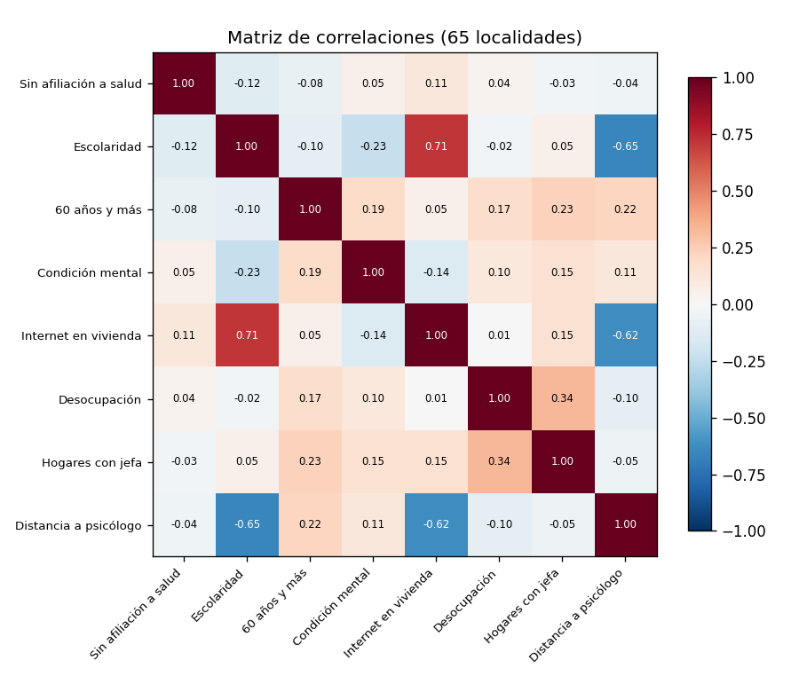
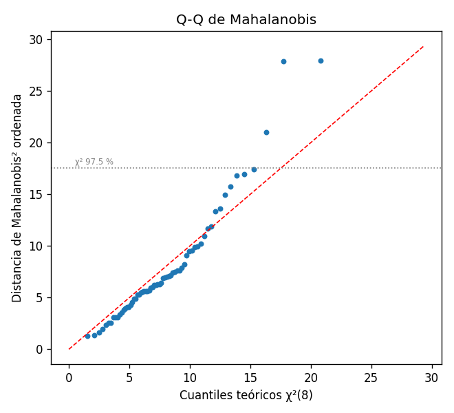
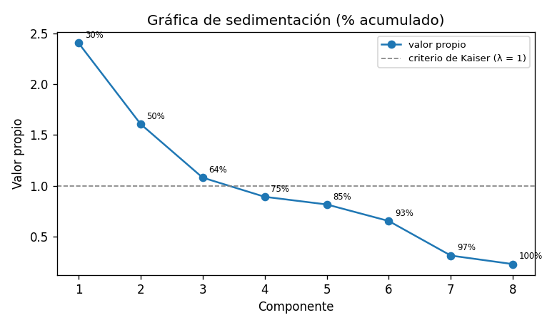
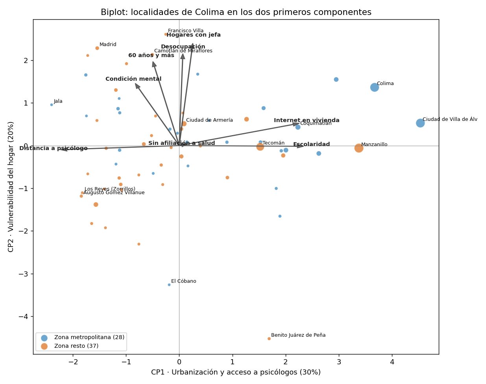
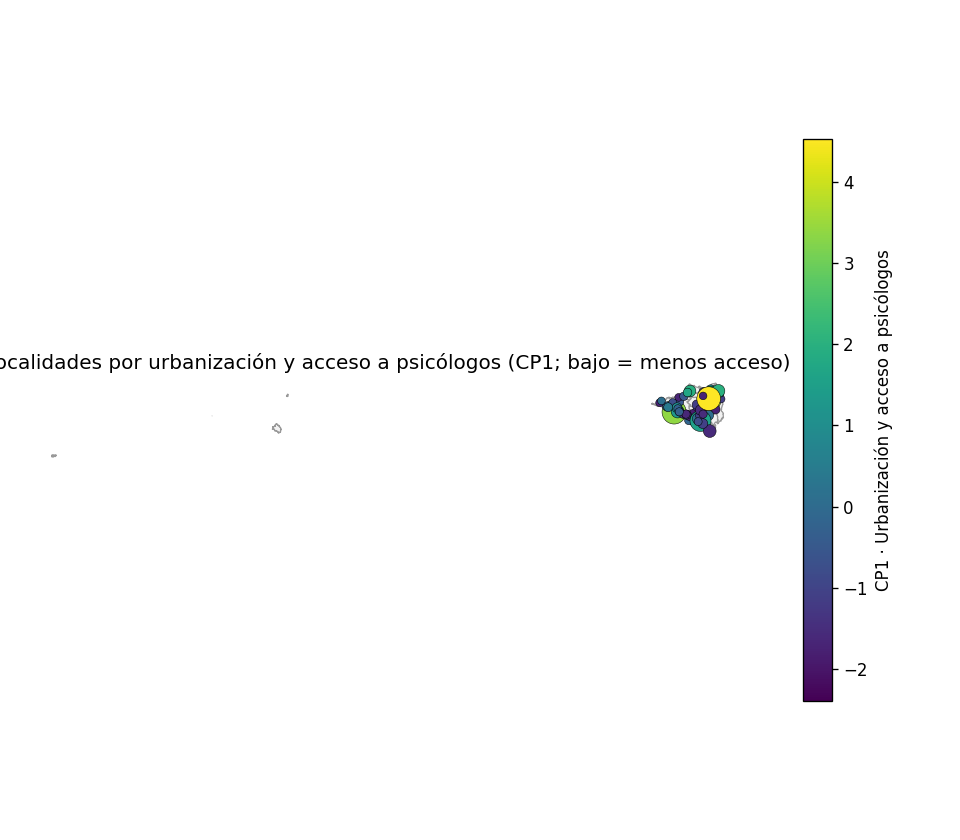

# E3 · Análisis Estadístico: mapa multivariado de las localidades de Colima

**Pregunta analítica E3 (de la propuesta de E0):** ¿qué zonas de Colima tienen mucha necesidad de atención en salud mental y poca oferta de consultorios de psicología?

- **Código:** `src/multivariado.py`. Para reproducirlo: `python src/multivariado.py`, que tarda unos 25 s.
- **Tabla Oro nueva:** `data/oro/localidades_colima.csv`. Trae las coordenadas de cada localidad en los componentes principales CP1 y CP2, y tiene linaje hacia Bronce en sus columnas `archivo_bronce` y `fila_bronce`.
- **Salidas:** las gráficas y tablas están en `docs/E3/multivariado/` y todos los números en `docs/E3/multivariado/resumen.json`.

## 0. Cambio de unidad de análisis respecto a E0 (y por qué)

En E0 se propusieron los **10 municipios** como unidades. Con 10 observaciones y 5 o más variables, la matriz de covarianzas apenas tiene grados de libertad. Así, la prueba de Mardia y el MANOVA no tendrían poder, y la M de Box ni siquiera se puede calcular, porque necesita más observaciones que variables en cada grupo.

**Decisión:** bajar un nivel en la jerarquía que ya se usaba en Oro (estado → zona → municipio → **localidad**). Las unidades son las **65 localidades con 500 habitantes o más** del Censo 2020 (ITER), donde vive el 96 % de la población del estado. Debajo de 500 habitantes, el INEGI reserva datos con "\*" y los porcentajes son muy inestables: en una localidad de 30 personas, una sola persona equivale al 3 %. La pregunta de E0 sigue siendo la misma, y los grupos también: la zona y el nivel de oferta del municipio, ambos definidos en E0 y E2.

Las 65 localidades pasaron por una Puerta de Calidad en Pandera con rangos de 0 a 100 para los porcentajes, coordenadas dentro de Colima y llave única. Ninguna se fue a cuarentena (`data/cuarentena/censo2020_localidades_cuarentena.csv` está vacío).

## 1. Matriz multivariada: 65 localidades × 8 variables

| Variable | Qué mide | Fuente | Media | Desv. |
|---|---|---|---|---|
| `pct_sin_afiliacion` | % de la población sin afiliación a ningún servicio de salud | Censo (PSINDER) | 15.6 | 6.5 |
| `escolaridad_prom` | Grado promedio de escolaridad (años) | Censo (GRAPROES) | 8.2 | 1.1 |
| `pct_60ymas` | % de 60 años y más | Censo | 14.3 | 4.3 |
| `pct_condicion_mental` | % con algún problema o condición mental | Censo (PCLIM_PMEN) | 1.6 | 1.0 |
| `pct_viv_internet` | % de viviendas con internet | Censo (VPH_INTER) | 33.6 | 16.9 |
| `pct_desocupacion` | % de la población económicamente activa sin empleo | Censo | 1.3 | 0.8 |
| `pct_hogares_jefa` | % de hogares con persona de referencia mujer | Censo | 30.2 | 8.8 |
| `log_dist_psicologo` | log(1 + km al consultorio de psicología más cercano) | DENUE + Censo (unión espacial, EPSG:6372) | 2.0 (≈ 8.9 km) | 0.9 |

- **Por qué se usa el logaritmo de la distancia:** la distancia está muy sesgada (mediana de 7.5 km y máximo de 23.6 km). Además, pasar de 0 a 5 km cambia mucho más el acceso que pasar de 15 a 20 km. El logaritmo refleja esa diferencia y acerca la variable a una distribución normal.
- Las matrices de covarianzas y de correlaciones están en `covarianzas.csv` y `correlaciones.csv`.

Lo más fuerte de la matriz es el bloque formado por **escolaridad, internet y cercanía al psicólogo**: las localidades más escolarizadas y conectadas son también las que tienen un psicólogo cerca.

## 2. Normalidad multivariada

| Prueba | Estadístico | p | Conclusión |
|---|---|---|---|
| Mardia, asimetría | b₁,ₚ = 27.1; χ²(120) = 293.6 | < 0.001 | Se rechaza la normalidad |
| Mardia, curtosis | b₂,ₚ = 95.6 (se esperaba 80); z = 4.96 | < 0.001 | Se rechaza la normalidad (colas pesadas) |

En la Q-Q de Mahalanobis, la mayoría de los puntos sigue la diagonal, pero la cola superior se separa. Tres localidades pasan el corte χ²₈ del 97.5 %:
- **Jala** (Coquimatlán): es la de menor escolaridad e internet.
- **Río Marabasco** (Manzanillo): está lejos de todo.
- **Benito Juárez de Peña Colorada** (Minatitlán): es un poblado minero, con población joven y muy pocos hogares con jefa.

Ninguna es un error de captura, así que **se conservan**: son perfiles reales y distintos.

**Qué implica:** el MANOVA clásico supone normalidad multivariada. Por eso (a) se reporta la **traza de Pillai**, que es el estadístico más robusto ante la falta de normalidad y de homogeneidad, y (b) el resultado se confirma con una **prueba de permutación**, que no supone ninguna distribución (sección 4).

## 3. Componentes principales

**Estandarización:** las variables están en unidades muy distintas (años, %, log-km) y la varianza de internet (≈ 287) es más de 400 veces la de desocupación (≈ 0.7). Sin estandarizar, el CP1 sería prácticamente "internet". Por eso el PCA se hace sobre la **matriz de correlaciones**, es decir, con las variables en puntaje z.

| Componente | Valor propio | % de varianza | % acumulado |
|---|---|---|---|
| CP1 | 2.41 | 30.1 % | 30.1 % |
| CP2 | 1.61 | 20.1 % | 50.2 % |
| CP3 | 1.08 | 13.5 % | 63.7 % |
| CP4 | 0.89 | 11.2 % | 74.9 % |

El criterio de Kaiser (λ > 1) retiene **3 componentes**, y la gráfica de sedimentación se quiebra después del CP2. Para el mapa del tablero se usan CP1 y CP2, que juntos explican el 50 %. El CP3 se interpreta aparte.

**Cargas** (correlación entre cada variable y el componente; en negritas las mayores a 0.4 en valor absoluto):

| Variable | CP1 | CP2 | CP3 |
|---|---|---|---|
| Escolaridad | **0.89** | 0.00 | −0.18 |
| Internet en vivienda | **0.86** | 0.16 | 0.06 |
| Distancia a psicólogo (log) | **−0.85** | −0.03 | −0.13 |
| Condición mental | −0.31 | **0.45** | 0.24 |
| 60 años y más | −0.19 | **0.61** | −0.29 |
| Desocupación | 0.03 | **0.67** | 0.13 |
| Hogares con jefa | 0.10 | **0.75** | −0.05 |
| Sin afiliación a salud | 0.02 | 0.00 | **0.93** |

**Nombres de negocio:**
- **CP1 · "Urbanización y acceso a psicólogos".** Cuando es alto, la localidad tiene más escolaridad, más internet y un psicólogo cerca. Cuando es bajo, la localidad está aislada. Para la cliente, este es el eje de **acceso**.
- **CP2 · "Vulnerabilidad del hogar".** Cuando es alto, hay más adultos mayores, más hogares sostenidos por una mujer, más desempleo y más personas con alguna condición mental. Este es el eje de **necesidad**. Es casi independiente del CP1: la vulnerabilidad existe tanto en el campo como en la ciudad.
- **CP3 · "Sin cobertura de salud".** Prácticamente es una sola variable, el % sin afiliación. Mide quién no tiene IMSS, ISSSTE ni otra institución y, por lo tanto, solo puede atenderse en la consulta privada o en ningún lado.

El signo de cada componente se fija en el código: escolaridad positiva en CP1 y 60 años y más positiva en CP2. Así, los nombres siguen siendo correctos aunque el algoritmo devuelva los vectores con el signo invertido.

## 4. El mapa: biplot de CP1 × CP2

**Cómo leerlo:** cada punto es una localidad y su tamaño es proporcional a la población. Las flechas indican hacia dónde crece cada variable.
- **Derecha:** las ciudades con acceso (Villa de Álvarez, Colima, Manzanillo, Comala, Cuauhtémoc).
- **Izquierda:** las localidades aisladas, sin un psicólogo cerca.
- **Arriba:** los hogares más vulnerables.
- **Cuadrante superior izquierdo (alta necesidad y bajo acceso):** aquí está el hueco de oferta que busca la pregunta E3. Ahí aparecen **Madrid (Tecomán)**, **Camotlán de Miraflores (Manzanillo)**, **Jala (Coquimatlán)** y varias localidades de la costa (zona "resto", en naranja).

## 5. MANOVA: ¿los grupos difieren en el perfil completo?

### 5.1 Zona metropolitana (28 localidades) vs resto del estado (37)

| Estadístico | Valor | F(8, 56) | p |
|---|---|---|---|
| **Lambda de Wilks** | 0.577 | 5.14 | < 0.001 |
| **Traza de Pillai** | 0.424 | 5.14 | < 0.001 |
| Pillai por permutación (4 999 permutaciones) | 0.424 | — | **0.0002** |
| M de Box (igualdad de covarianzas) | χ²(36) = 63.4 | — | 0.003 ✗ |

- **Lectura de Wilks:** Λ = 0.577 significa que el 58 % de la variabilidad multivariada queda *dentro* de los grupos. Es decir, la zona explica alrededor del 42 % del perfil (1 − Λ).
- **Lectura de Pillai:** con dos grupos coincide con 1 − Λ, porque hay un solo eje discriminante y las cuatro pruebas dan la misma F.
- Las covarianzas no son iguales entre los grupos (la M de Box se rechaza). Por eso la conclusión se apoya en la **permutación**, que no necesita ese supuesto: **p = 0.0002**.

### 5.2 Nivel de oferta del municipio: alta (30), media (22) y baja (13)

| Estadístico | Valor | F | p |
|---|---|---|---|
| **Lambda de Wilks** | 0.521 | F(16, 110) = 2.65 | 0.0015 |
| **Traza de Pillai** | 0.552 | F(16, 112) = 2.67 | 0.0014 |
| Pillai por permutación | 0.552 | — | **0.002** |
| M de Box | χ²(72) = 82.2 | — | 0.19 ✓ |

### 5.3 Por qué no es lo mismo que correr 8 ANOVA separados

| Variable | ANOVA por zona: p | Bonferroni | ANOVA por oferta: p | Bonferroni |
|---|---|---|---|---|
| Sin afiliación | 0.34 | 1 | 0.011 | 0.091 |
| Escolaridad | 0.039 | 0.31 | 0.086 | 0.69 |
| 60 años y más | 0.025 | 0.20 | 0.82 | 1 |
| Condición mental | 0.39 | 1 | 0.43 | 1 |
| Internet | **0.001** | **0.008** | 0.86 | 1 |
| Desocupación | 0.44 | 1 | 0.70 | 1 |
| Hogares con jefa | 0.20 | 1 | 0.024 | 0.19 |
| Distancia a psicólogo | **0.002** | **0.015** | 0.10 | 0.80 |

1. **Error tipo I acumulado:** con 8 ANOVA al 5 %, la probabilidad de obtener al menos un falso positivo es 1 − 0.95⁸ ≈ **34 %**. La corrección de Bonferroni lo controla, pero a costa de perder poder. El MANOVA hace **una sola prueba** con un α de 5 % real.
2. **El MANOVA aprovecha las correlaciones:** por **oferta, ninguna variable sale significativa sola** después de corregir por Bonferroni, y aun así el MANOVA es claro (p = 0.001). Los grupos no se separan por una variable aislada, sino por una **combinación**: los municipios de oferta baja tienen a la vez menos escolaridad, más hogares con jefa y más distancia. Cada diferencia por separado es pequeña, pero juntas forman un perfil distinto. Varios ANOVA no detectan algo así.
3. **Por zona** sí hay dos variables que destacan solas: internet y distancia al psicólogo. El MANOVA confirma que, en conjunto, son perfiles distintos.

## 6. Interpretación para la cliente

> "En el estado hay dos realidades. Las ciudades de la zona metropolitana y Manzanillo concentran la escolaridad, el internet y los consultorios. La costa y la sierra tienen un perfil distinto: un psicólogo a 15 o 24 km y hogares más vulnerables. El caso más claro es **Cerro de Ortega (Tecomán)**: tiene 9,300 habitantes y el consultorio de psicología registrado más cercano está a **24 km**. También destacan Madrid (Tecomán, 3,300 hab., a 15 km) e Ixtlahuacán (3,000 hab., a 17 km). Como estas localidades tienen poco internet, la terapia en línea tampoco resuelve del todo el problema. Si usted piensa abrir una segunda sede o dar consulta itinerante, **la costa de Tecomán y Armería** es donde hay más población sin oferta cercana. En el centro de Colima, en cambio, la competencia es alta."

## 7. Limitaciones

- **Lo que registra el DENUE:** el DENUE solo incluye los consultorios *registrados* como establecimiento. Un psicólogo que atiende en un consultorio médico general o solo en línea no aparece, así que la distancia real puede ser menor.
- **Fechas distintas:** los datos del Censo son de 2020 y los del DENUE de 2026. Es una mezcla de años; el internet, por ejemplo, ya creció desde 2020.
- **Las tasas de suicidio no entran:** no se pueden usar a nivel localidad (con pocos casos, las tasas son inestables) y por eso no forman parte de la matriz. La necesidad se aproxima con indicadores sociodemográficos.
- **Normalidad:** no se cumple, así que los valores p paramétricos se toman como orientativos y la conclusión descansa en la prueba de permutación.
