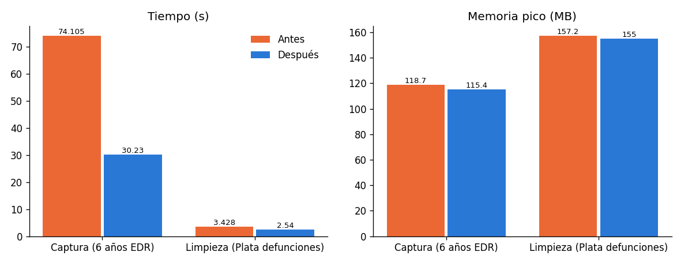

# E3 · Ingeniería de Datos: optimización medida del pipeline

- **Código:** `src/optimizacion.py`. Corre cada condición en un proceso nuevo y guarda las mediciones.
- **Datos crudos:** `docs/E3/optimizacion/mediciones.csv`; el resumen está en `docs/E3/optimizacion/resumen.json`.
- **Fecha de medición:** 2026-11-24, en una laptop con Windows 11 y Python 3.13.
- **Reproducir:** `python src/optimizacion.py` (unos 5 min, porque descarga del INEGI) o `python src/optimizacion.py --sin-red` (solo la limpieza).

## Resumen

| Etapa | Métrica | Antes | Después | Mejora |
|---|---|---|---|---|
| **Captura** (EDR 2018–2023, corrida completa) | Tiempo total | 74.1 s | 30.2 s | **−59 %** |
| | Tiempo sin las pausas de cortesía (5 × 5 s) | 49.1 s | 5.2 s | **−89 %** |
| | Datos descargados del INEGI | 192.6 MB (6 archivos) | **0 MB** (6 consultas de 1 byte) | **−100 %** |
| | Memoria de trabajo | 6.8 MB | 3.5 MB | −49 % |
| | Archivos marcados como "cambiados" sin haber cambiado | 6 de 6 se bajaban siempre | **0 de 6** | **−100 %** |
| **Limpieza** (Plata de defunciones, 37,136 registros; 5 réplicas por condición) | Tiempo | 3.43 ± 0.24 s | **2.54 ± 0.10 s** | **−26 %** (Welch p = 0.0004) |
| | Memoria de trabajo | 45.6 MB | 43.3 MB | −5 % |
| | Errores y registros en cuarentena | 0 | 0 | = |
| **Calidad** (no puede empeorar) | SHA-256 de `data/plata/defunciones.csv` | `c89d3650…` | `c89d3650…` | **Idéntico byte a byte** |
| | Archivos de Bronce | — | sin cambios | ✔ |

**Cómo se leen las métricas:**
- **Memoria:** la "memoria de trabajo" es el pico del proceso menos lo que ocupan las bibliotecas ya cargadas, unos 110 MB que son iguales en ambas condiciones. El pico total del proceso también está en el JSON: 157 contra 155 MB en la limpieza.
- **Tiempo:** el cronómetro arranca **después** de importar pandas y Pandera. Importarlas tarda unos 4 s y es igual en las dos condiciones; en la primera versión de la medición estaba incluido y escondía la diferencia (ver la sección 4).

## 1. Optimización de la captura: la "huella" HTTP

**Problema:** cada corrida completa (el día 5 de cada mes, o cuando alguien la corre a mano) descargaba los **6 ZIP de defunciones, 193 MB en total**, para después calcular su SHA-256 y descubrir que eran idénticos a los de la vez anterior. En GitHub Actions ese paso tardaba **4 min 00 s** (corrida del 2026-11-23). Era tiempo perdido y además carga innecesaria para los servidores del INEGI.

**Cambio** (`src/comun.py`: `huella_remota`, `sin_cambios`, `guardar_huella`):
1. Antes de descargar, se pide **solo el primer byte** del archivo (`Range: bytes=0-0`). El INEGI responde `206 Partial Content` con el ETag, la fecha de modificación (`Last-Modified`) y el **tamaño total** (`Content-Range`).
2. Esos datos se comparan con la huella de la última descarga confirmada, guardada en `data/bronce/huellas_http.csv`.
3. Si son iguales, **no se descarga**. Si son distintos, faltan o el servidor responde HTML, se descarga como antes. *Ante la duda, siempre se baja el archivo.*

**Lo que se descubrió al medir:** la primera versión comparaba solo el ETag, y aun así **4 de los 6 archivos** se descargaban. El INEGI tiene **varios servidores con copias** del mismo archivo, y cada copia tiene su propio ETag y una fecha que difiere por segundos. Se comprobó con 3 peticiones seguidas al archivo de 2018: dos servidores distintos respondieron 12:00:15 y 12:00:25, con el mismo tamaño de 23,619,430 bytes. La regla quedó así:

> **Sin cambios** ⇔ el mismo tamaño en bytes **y** (un ETag ya visto para esa URL **o** una fecha de modificación a ≤ 10 minutos)

Cada ETag nuevo se agrega a la lista **solo después** de que el SHA-256 confirma que el contenido es el mismo. Así, el sistema aprende las copias de cada servidor. Una publicación nueva del INEGI cambia el tamaño o la fecha por días o meses. Por ejemplo, el archivo de 2022 tiene fecha del 21-jul-2026 y los demás del 10-nov-2025.

**Riesgo residual:** que el INEGI reemplace un archivo con otro **del mismo tamaño exacto** y en los mismos 10 minutos. Es prácticamente imposible con archivos de 20 a 40 MB. Aun si pasara, la siguiente corrida que descargue el archivo lo detectaría por el SHA-256.

**Pruebas:** `test_huella_igual_evita_descarga`, `test_huella_distinta_o_sin_soporte_descarga` y `test_huella_otro_servidor_mismo_archivo`.

La misma lógica se aplicó al **DENUE**, que es la captura **diaria**. Ahí el ahorro se repite todos los días en los que el INEGI no actualiza el directorio.

## 2. Optimización de la limpieza (Plata)

Se aplicaron dos cambios en `src/plata.py`:

**a) Leer solo las columnas necesarias: la combinación ganadora del experimento de E2.**
- En el experimento factorial 2³ de E2, el factor **B, columnas leídas** (todas o solo las necesarias), tuvo el efecto más grande: **−1.35 s**.
- El factor A, motor de lectura, se queda en `c`, porque `pyarrow` tuvo una **tasa de error del 100 %** en el experimento.
- El factor C, formato del intermedio, **no se aplicó**. Su efecto fue pequeño (−0.09 s), y cambiar Plata de CSV a Parquet rompería la legibilidad en git y la compatibilidad con el tablero y las pruebas. Se documenta como decisión.
- Ahora se leen 14 columnas en lugar de 59 a 74 por año.

**b) Un cuello de botella encontrado con el perfilador (cProfile).**
- `leer_bronce` construía el `id_registro` de linaje calculando `Path(ruta).stem` **una vez por cada fila**: 37,136 veces para obtener siempre el mismo texto.
- cProfile mostró que eso consumía **el 24 % del tiempo** de Plata (1.5 de 6.4 s).
- Ahora se calcula una sola vez y se concatena de forma vectorizada.

El `id_registro` resultante es idéntico, así que **el linaje no cambia**.

**Prueba de que no se rompió nada:** el SHA-256 de `data/plata/defunciones.csv` es el mismo en las 10 corridas, y `test_reproducibilidad` compara todo Plata y Oro contra las versiones guardadas.

## 3. Errores

| Tipo de error | Antes | Después |
|---|---|---|
| Excepciones en las corridas medidas | 0 de 6 | 0 de 6 |
| Registros a cuarentena | 0 | 0 |
| Descargas innecesarias ("falsos cambios") | 6 de 6 por corrida | 0 de 6 |
| Exposición a fallas de red (datos transferidos por corrida completa) | 193 MB | unos pocos KB (solo encabezados) |
| Falla al guardar los datos en Actions (conflicto de push, 2026-11-23) | 1 de 2 intentos | Se agregó `git pull --rebase` antes del push. **La evidencia de que ya no falla vendrá de la bitácora** de las próximas corridas diarias (`data/bitacora/capturas.csv`) |

**Una aclaración honesta:** el pipeline ya no tenía errores de datos antes de esta etapa. La Puerta de Calidad se ocupó de eso en E1, así que en errores de datos no hay nada que reducir (0 → 0). La reducción medible está en las **descargas innecesarias**, que eran 100 % de falsos cambios y ahora son 0, y en la **exposición a fallas de red**: cada MB que no se descarga es un MB que no puede interrumpirse por un timeout del INEGI.

## 4. Cómo se midió (y un error de medición corregido)

- **Aislamiento:** cada condición corre en un **proceso nuevo** (`subprocess`). Así la memoria pico es la de esa corrida y la caché de Python no favorece a la segunda.
- **Orden:** en la limpieza, 5 réplicas **intercaladas** (antes, después, antes, …), para que el calentamiento del disco no beneficie a una sola condición.
- **Captura:** 1 corrida por condición, por cortesía con el INEGI; cada corrida "antes" baja 193 MB. La diferencia (6 descargas contra 0) es determinista, no estadística.
- **Memoria:** la memoria pico del proceso (*working set*) se lee con la API de Windows (`GetProcessMemoryInfo`) o con `resource.getrusage` en Linux. No usa dependencias extra.
- **El "antes" es el código real anterior:** con `OPTIMIZACION_E3=0` se ejecuta el código anterior dentro del mismo archivo, así que no se compara contra una versión hipotética.
- **Error de medición corregido:**
  - La primera medición **incluía el tiempo de importar** pandas y Pandera, unos 4 s, y daba "antes" 7.7 s contra "después" 7.1 s, una diferencia no significativa.
  - Al mover el cronómetro después de las importaciones apareció la diferencia real: **3.43 contra 2.54 s**, con p = 0.0004.
  - La primera versión de la memoria de Windows devolvía 0 MB, porque el *handle* del proceso se truncaba; se corrigió declarando los tipos con ctypes.
